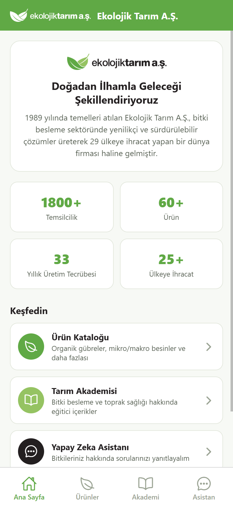
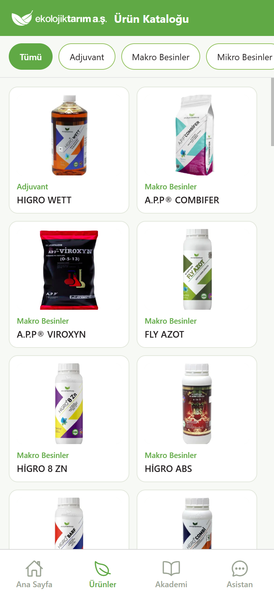
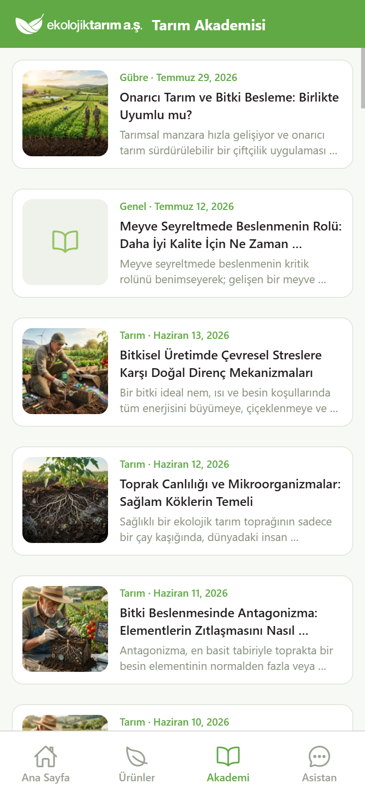
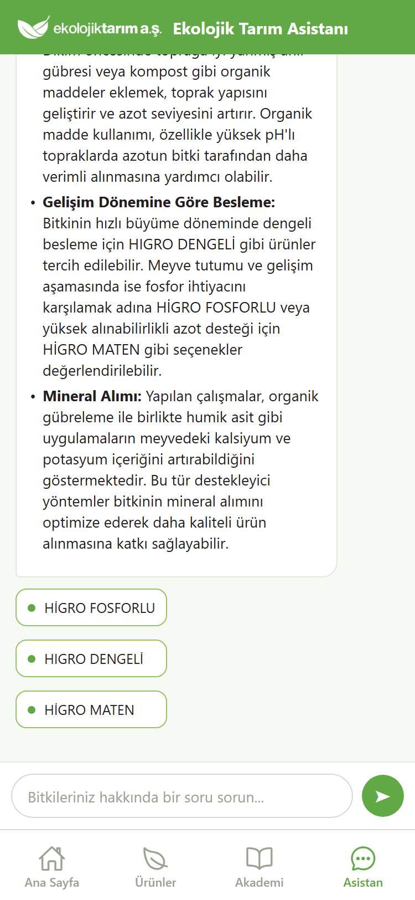

# Agro-Botany RAG & Product Linker System

A production-ready, Python RAG backend that powers a mobile-app chatbot and a
web widget for an ecological agriculture company
([ekolojiktarim.com.tr](https://www.ekolojiktarim.com.tr/)).

The AI acts as an **expert Agricultural Engineer (Ziraat Mühendisi)** covering
**any plant-related topic** — nutrition, soil health, physiology, horticulture,
agronomy, propagation, irrigation, post-harvest, and the **organic** management
of plant diseases and pests — across all crops. Non-plant topics (animal
husbandry, economics, machinery) are out of scope. Two hard rules always hold:
**never give a definitive disease diagnosis** and **never recommend chemical
pesticides/drugs**. Plus automatic language matching and off-scope refusal.

---

## Screenshots

The mobile app (Expo / React Native) mirrors the company site with Home,
Products, Academy, and AI Assistant tabs, all driven by live scraped data and
the RAG backend.

| Home | Products |
| --- | --- |
|  |  |

| Academy | AI Assistant |
| --- | --- |
|  |  |

---

## Architecture

```
User query ─▶ FastAPI /api/chat ─▶ RAG Engine
                                     ├─ Botany retrieval   (ChromaDB, local embeddings)
                                     ├─ Product matching   (scraped catalog JSON)
                                     └─ LM Studio chat      (Gemma, OpenAI-compatible)
                                           ▲
                                   Strict system prompt
                                   (persona + guardrails + language rule)
```

| Layer            | Choice                                             |
| ---------------- | -------------------------------------------------- |
| LLM provider     | LM Studio local server (`http://localhost:1234/v1`)|
| RAG framework    | LangChain                                          |
| Vector DB        | ChromaDB (persistent, local)                       |
| Backend API      | FastAPI + Uvicorn                                  |
| Doc processing   | pypdfium2 + RecursiveCharacterTextSplitter (1000/200)|
| Scraping         | requests + BeautifulSoup                           |
| Tests / quality  | pytest (50 tests) + `evals/` quality harness       |

---

## Safety guardrails (enforced on every query)

- **No definitive disease diagnosis.** Describes likely causes/symptoms as
  possibilities and points to a professional for certainty.
- **No chemical pesticides / medical treatments / illegal substances** — even
  when asked directly. Disease/pest questions are answered with **organic,
  cultural, and biological** management (a helpful organic path, not a dead end).
- **Scope:** plant topics only. Non-plant questions get a brief refusal, and
  product suggestions are suppressed for them (LLM `[OFFSCOPE]` marker →
  `_strip_offscope` in `src/engine.py`).
- **Advisory, non-prescriptive** tone ("bunun sebebi ... olabilir").
- **Language matching:** the full response is generated in the same language
  as the user's query (works across languages via the multilingual embedder).

Guardrails live in `src/config.py` (`SYSTEM_PROMPT`) and are injected into the
system message on every call in `src/engine.py`. They are covered by unit tests
(`tests/test_engine.py`) and the eval harness (`evals/`).

---

## Project layout

```
agro-rag-system/
├── data/vector_store/     # persistent ChromaDB files (generated)
├── docs/
│   ├── books/             # put botany PDFs / TXTs here
│   └── products/          # scraped products.json (generated)
├── src/
│   ├── config.py            # endpoints, models, paths, SYSTEM_PROMPT
│   ├── scraper.py           # crawl product catalog (mock fallback)
│   ├── articles_scraper.py  # crawl academy articles
│   ├── scrape_utils.py      # shared HTTP crawl helpers (site scrapers)
│   ├── fetch_books.py       # download English books from Internet Archive
│   ├── fetch_dergipark.py   # harvest Turkish papers from DergiPark (OAI-PMH)
│   ├── fetch_openalex.py    # harvest global-crop OA papers from OpenAlex
│   ├── pdf_fetch_utils.py   # shared PDF stream/validate helpers (all fetchers)
│   ├── ingest.py            # chunk + embed docs -> Chroma (incremental)
│   ├── engine.py            # retrieval + product match + LM Studio
│   └── main.py              # FastAPI app
├── tests/                   # pytest unit tests (fetchers, ingest, engine, API)
├── evals/                   # repeatable RAG quality harness (run_eval.py)
├── requirements.txt
└── README.md
```

---

## Quickstart

> **Note on a fresh clone:** the repo ships the code and the scraped
> `products.json` / `articles.json`, but **not** the botany knowledge base.
> The vector store (`data/vector_store/`, ~700 MB) and the source PDFs
> (`docs/books/`) are gitignored because of their size. On a new machine you
> either copy those two folders over manually, or rebuild them with steps 4–5
> below. Without them the API still runs, but the assistant has no botany
> knowledge to ground its answers. See **Running on a new machine** at the end.

### 1. Install dependencies

```bash
python -m venv .venv
# Windows:  .venv\Scripts\activate
# Unix:     source .venv/bin/activate
pip install -r requirements.txt
```

### 2. Start LM Studio

In LM Studio, load a chat model (e.g. a local Gemma build) and an embedding
model, then start the **local server** on port `1234`. Set the exact model
names in a `.env` file (copy `.env.example`).

### 3. Build the product catalog

```bash
python -m src.scraper          # live crawl, mock fallback on failure
python -m src.scraper --mock   # force offline mock catalog
```

Writes `docs/products/products.json`.

### 4. Get botany documents

Either drop your own PDFs / TXTs into `docs/books/`, or bulk-download
open-access / public-domain material from three sources:

```bash
# English books from the Internet Archive (curated plant-nutrition sources)
python -m src.fetch_books --list-sources               # show curated sources
python -m src.fetch_books --max 50                     # fetch from all sources
python -m src.fetch_books --source soil_health --max 20  # one source only

# Turkish agriculture papers from DergiPark (OAI-PMH)
python -m src.fetch_dergipark --list-sets              # show matched journals
python -m src.fetch_dergipark --max 120                # harvest PDFs
python -m src.fetch_dergipark --clean-offtopic         # report livestock papers
python -m src.fetch_dergipark --clean-offtopic --apply # move them out + prune store

# Global-crop open-access papers from OpenAlex (cassava, sorghum, rice, ...)
python -m src.fetch_openalex --list-crops              # show curated gap crops
python -m src.fetch_openalex --dry-run --max 25        # preview candidates
python -m src.fetch_openalex --max 25 --per-crop 4     # harvest PDFs
```

Only freely downloadable, non-restricted items are fetched (borrow-only / DRM
items are skipped), and each PDF is validated before it is kept. The DergiPark
fetcher filters out off-topic (animal-science / fisheries) papers; the
`--clean-offtopic` pass reports (and with `--apply` removes) any that already
slipped into the corpus.

### 5. Ingest botany documents

With documents in `docs/books/`:

```bash
python -m src.ingest           # incremental: skips files already in the store
python -m src.ingest --force   # re-embed every file (e.g. after a filter change)
python -m src.ingest --reset   # drop the collection and rebuild from scratch
```

Persists embeddings to `data/vector_store/`. (Requires LM Studio's embedding
model to be running.) Ingestion is incremental — already-embedded files are
skipped, so re-runs only process new documents unless you pass `--force`.

### 6. Run the API

```bash
uvicorn src.main:app --reload --host 0.0.0.0 --port 8000
```

Open http://localhost:8000/docs for the interactive Swagger UI.

---

## Testing & quality

```bash
python -m pytest                    # 50 unit tests (fetchers, ingest, engine, API)

# Repeatable RAG quality eval (needs LM Studio's embedding model; full mode also
# needs the chat model). Measures retrieval, product gating, grounding, guardrails.
python -m evals.run_eval --fast     # retrieval + product gating only (seconds)
python -m evals.run_eval            # full: also generates answers + keyword checks
```

The eval turns corpus/scope changes into measured deltas rather than spot checks,
and exits non-zero on any failure (so it can gate CI). Cases live in
`evals/eval_set.py`.

---

## API

### `POST /api/chat`

Request:

```json
{
  "message": "Domates yapraklarım sararıyor, ne önerirsiniz?",
  "history": [{"role": "user", "content": "Merhaba"}],
  "stream": false
}
```

Unified response:

```json
{
  "answer": "Yaprak sararmasının sebebi azot eksikliği olabilir ...",
  "recommended_products": [
    {"title": "Solucan Gübresi (Vermikompost)", "link": "https://..."}
  ]
}
```

Set `"stream": true` to receive Server-Sent Events: a first `products` event,
then `token` events, then a `done` event.

### `GET /health`

Liveness probe.

---

## Mobile app

The `mobile-app/` folder is an Expo (React Native) app with Home, Products,
Academy, and Chat tabs. It talks to the same backend API.

```bash
cd mobile-app
npm install
npm run web        # browser preview
npx expo start     # dev server for Expo Go / device
```

**Point it at your backend.** A physical phone cannot reach `127.0.0.1` — that
is the phone itself. Set `API_BASE` in `mobile-app/src/api.ts` to the host
machine's LAN IP (both devices on the same Wi-Fi), e.g.:

```ts
export const API_BASE = "http://192.168.1.103:8000";
```

The IP is assigned by your router (DHCP) and can change; check it with
`ipconfig` (Windows) / `ifconfig` (Unix) and update it here. Also allow the
backend port through the OS firewall so the phone can connect.

**Build an installable APK.** Cloud build via EAS
(`eas build -p android --profile preview`), or a local Gradle build after
`npx expo prebuild -p android` → `./gradlew assembleRelease`. The self-contained
release APK lands in
`android/app/build/outputs/apk/release/app-release.apk`.

---

## Running on a new machine

A `git clone` alone is **not** a fully working system. Checklist:

1. **Python deps** — `pip install -r requirements.txt`.
2. **LM Studio** — install it, download a chat model (e.g. Gemma) and an
   embedding model (e.g. bge-m3), start the local server on port `1234`, and
   set the exact model ids in `.env` (copy `.env.example`).
3. **Knowledge base** — copy `data/vector_store/` and `docs/books/` from the
   original machine, **or** rebuild with `python -m src.fetch_books` +
   `python -m src.ingest`. (A rebuild is *similar* but not identical — the
   Internet Archive returns different books over time.)
4. **Backend** — `uvicorn src.main:app --host 0.0.0.0 --port 8000`.
5. **Mobile app** — `npm install`, set `API_BASE` to the new machine's LAN IP,
   then rebuild the APK (see above).

Catalog data (`products.json`, `articles.json`) is committed, so the Products
and Academy tabs work immediately; re-run `python -m src.scraper` /
`python -m src.articles_scraper` only to refresh them.
